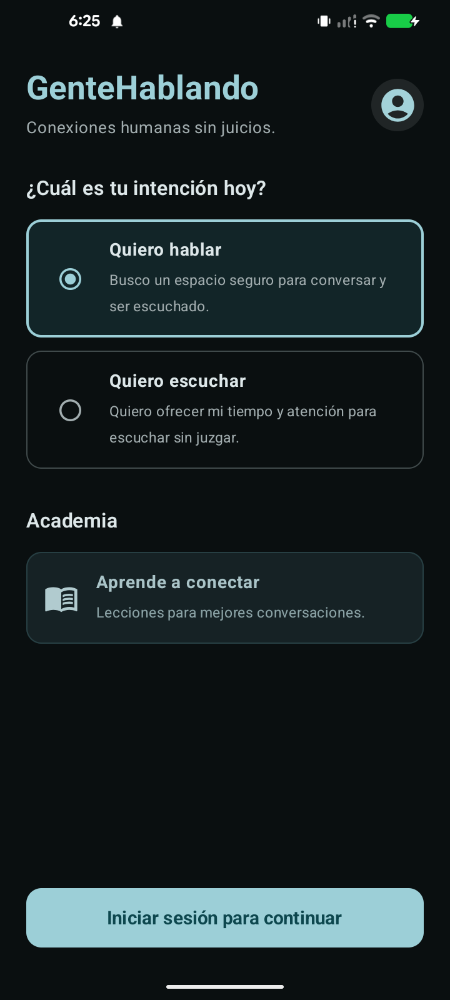
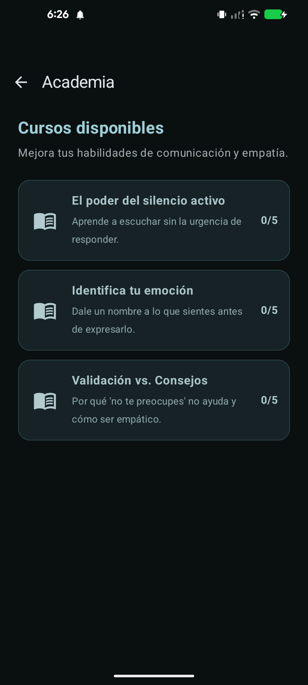
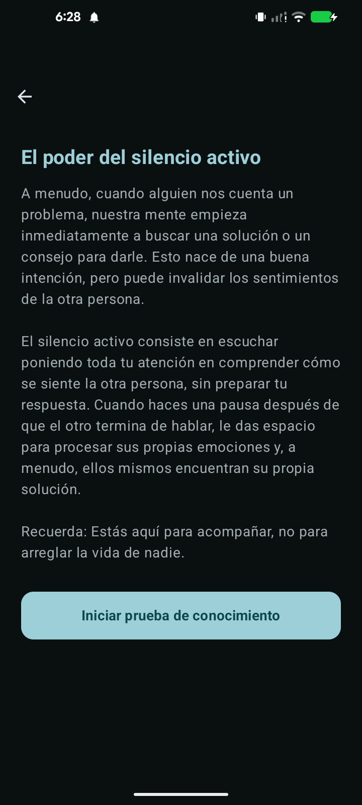

# GenteHablando

GenteHablando is an Android prototype for peer conversations. You choose whether to speak or listen, read the guidelines for that role, and request a conversation. The app also includes an academy with short lessons and quizzes about listening, emotions, and communication.

The product UI supports Spanish and English. This repository's documentation and contribution workflow use English.

**Prototype status:** the source includes Firebase-backed messaging and matchmaking, Google sign-in, and an Agora voice adapter. These integrations do not establish production readiness. The voice adapter currently joins a shared test channel instead of the requested conversation room. Do not use this build for private conversations.

## What the source includes

| Area | Current implementation and limits |
| --- | --- |
| Home and roles | Speaker/listener selection, access to the academy, and a sign-in prompt before starting a conversation. |
| Guidelines | Different guidance for each role and a ten-second reading countdown before searching. The guidance describes peer accompaniment, not professional therapy. |
| Authentication | Google sign-in through Firebase Auth. The data layer also contains local identity fallbacks; a local identifier does not prove Firebase authentication. |
| Conversations | Firestore matchmaking, room messages, typing indicators, and session-ending actions. Multi-user reliability needs verification and the corrections in the architecture report. |
| Voice | Microphone and noise-filter controls plus speaking indicators. The adapter uses a shared test channel and an embedded test token; room isolation and token provisioning need correction. |
| Feedback and profile | Ratings, conduct reports, connection-issue feedback, appeals, reputation, sign-out, and account-deletion actions. The repository does not establish an operating moderation service or complete data-erasure process. |
| Academy | Three bundled lessons, randomized five-question quizzes, a passing score of four, and a ten-minute retry cooldown after a failed attempt. The implementation stores progress locally and attempts Firebase synchronization. |

The app requests an email scope during Google sign-in and stores messages, feedback, appeals, and progress through its data adapters. Generic partner labels do not guarantee anonymous authentication, confidential storage, or a retention policy.

## Screenshots

We captured these screens on a physical Android 16 (API 36) device using the version 0.1.0 debug APK from [Android CI run 45909966972](https://github.com/JDRodriguezr/GenteHablando/actions/runs/45909966972), source `5c18af07db0b6eef27db8ea50b1bf52038b8b331`. We checked launch, academy and lesson navigation, the sign-in screen, and back navigation. We did not authenticate, start a conversation, or submit a quiz.

| Signed-out Home | Academy |
| --- | --- |
|  |  |

| Listening lesson | Sign-in screen |
| --- | --- |
|  |  |

## Stack

| Purpose | Technology present in the source |
| --- | --- |
| Android application | Kotlin, one `app` module |
| UI | Jetpack Compose and Material 3 |
| Navigation and state | Navigation Compose, Android ViewModels, coroutines, and Flow/StateFlow |
| Dependency injection | Hilt |
| Identity and remote data | Firebase Auth and Cloud Firestore |
| Google login | Google Play services sign-in |
| Voice | Agora RTC |
| Advertising | Google Mobile Ads |
| Local persistence | SharedPreferences for identity, course scores, and cooldowns |

## Setup

Start from `develop`:

```powershell
git clone --branch develop https://github.com/JDRodriguezr/GenteHablando.git
Set-Location GenteHablando
```

Open the checkout in Android Studio. Actions passed debug unit tests, lint and APK generation with this configuration:

| Component | Checked configuration |
| --- | --- |
| Java | JDK 17 launcher; Java 25 Gradle daemon criteria |
| Gradle | 9.6.0, through the checked-in wrapper |
| Android | AGP 8.8.0, SDK 35, Build Tools 35.0.0; minimum API 24 |
| Kotlin | 2.1.20; Java/Kotlin compilation target 17 |
| Compose | BOM 2026.02.01 |

The daemon criteria can override `JAVA_HOME`. Keep the wrapper, checksum, daemon criteria and version catalog together; diagnose actual CI failures before changing versions. See [CONTRIBUTING.md](CONTRIBUTING.md) for the runner command and artifact-download instructions.

Use an owner-approved test environment for Firebase and Agora configuration. Google sign-in requires the matching Firebase/OAuth client configuration and the approved build's signing registration. Do not copy tokens, account details, signing secrets, or runtime logs into documentation.

Run builds and automated tests in Actions rather than through local Gradle tests. Use an authorized physical Android device for runtime checks; do not use Android emulators for this workflow. Startup initializes Firebase and Google Mobile Ads and can contact their services. Obtain separate approval before production writes or deployment. A successful build alone does not verify Firebase rules, matchmaking, moderation, or voice isolation.

## Architecture

The app uses repository contracts, Hilt bindings, and ViewModels within a single module:

```text
ui/screens + ui/navigation
          |
          v
      viewmodel
          |
          v
  domain/repository + domain/model
          ^
          |
  data/repository -- Firebase / Agora / local preferences
          ^
          |
      di bindings
```

`RepositoryModule` binds the real Firebase implementations and the Agora adapter. The source also includes fake chat and matchmaking implementations, but the current bindings do not provide an isolated demo mode.

The matchmaking contract currently imports a ViewModel UI state, so that boundary still needs correction. Keep the single-module structure while addressing the 13 prioritized findings in the [architecture review](docs/architecture.md), which anchors its source observations to `56145e0945c21dffb0d008157f3d750b7f978e76`. Start with voice-room isolation, real identity handling and transactional matchmaking.

## Contribution workflow

Read [CONTRIBUTING.md](CONTRIBUTING.md) and [AGENTS.md](AGENTS.md). Use `feature/*` branches based on `develop`, with PRs targeting `develop`. Prepare releases on `release/x.y.z` branches targeting `main`, then synchronize `main` back to `develop`. Keep commits and PR descriptions short and in English, and maintain both product languages.

Merging, publishing tags or releases, and deploying require approval for that work. GitFlow checks validate PR branch relationships; an administrator must enable branch protection to restrict direct pushes and require reviews. The [administrator checklist](CONTRIBUTING.md#administrator-setup) does not imply that those protections are active.

## Product languages

Android selects the language through its native resources. Spanish lives in
`app/src/main/res/values/`; English lives in `values-en/`. Spanish remains the
default resource fallback. Regional English locales use the English resources.
On Android 13 and later, the system's app-language settings list Spanish and
English; older versions follow the device's language preferences. There is no
in-app language picker or automatic translation service.

Both languages cover the screens, role guidelines, dialogs, accessibility
labels, errors, counters, bundled lessons and quizzes. The UI resolves resources
at display time, including retained error reasons and generated demo messages.
Course IDs, question identities, option indices, progress keys, roles and
Firebase wire values remain language-independent. Quiz grading uses option
identity, not translated answer text. Message times use the selected locale and
the system's 12/24-hour preference. The app does not translate user messages,
appeal text, issue descriptions or identifiers.
SDK sign-in/ad screens and remote user content are outside the bundled
translation catalog.

Add new product text to both resource directories with matching names and types.
Keep array options in the same identity order, provide the required plural
quantities and retain numbered format arguments. Only the brand name and SDK
client IDs use `translatable="false"`. Technical Kotlin literals need a narrow
`// i18n: technical <specific reason>` comment; do not use this exception for
product copy, generated replies or aliases. See [CONTRIBUTING.md](CONTRIBUTING.md)
for the translation check and its limits.

The existing fake repositories remain test doubles, not a fallback for failed
Firebase operations. Localization does not change their production bindings or
resolve the [architecture backlog](docs/architecture.md). Quiz state still uses
the existing recreation behavior; this feature does not claim to preserve an
in-progress quiz across Activity recreation.

## Release status

Version 0.1.0 is an experimental source preview. See the [release history](https://github.com/JDRodriguezr/GenteHablando/releases). CI debug APKs are test artifacts, not production-signed distributions. Correct the shared voice-channel path before testing private conversations.

## Verification limits

Actions passed the GitFlow policy, Android debug unit tests, lint and APK generation for the checked preview. The Android unit suite includes focused quiz option-identity checks and the template arithmetic test. Physical-device checks cover the signed-out screens and navigation described above; the architecture report contains proposed acceptance checks, not completed integration tests.

Google sign-in, Firebase rules, end-to-end conversations, feedback retention, voice isolation, accessibility conformance and performance remain unverified. Do not treat this prototype as a stable release or evidence of operational readiness.
